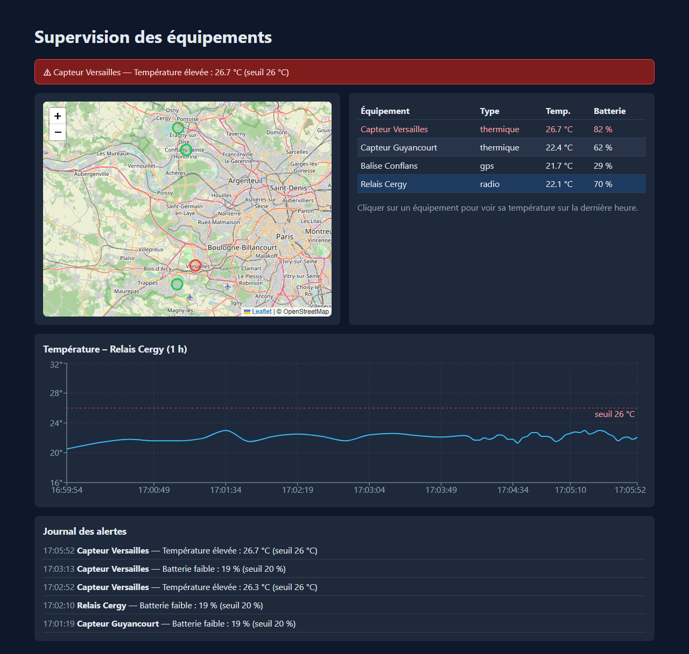

# Console IoT – supervision d'équipements en temps réel

[](https://github.com/mcpolo78/console-iot/actions/workflows/ci.yml)

Application fullstack TypeScript : un tableau de bord qui affiche sur une carte des équipements connectés (capteurs, balises, relais), leurs mesures en temps réel, les alertes de dépassement de seuil et l'historique de température.



**Démo en ligne** : https://console-iot-self.vercel.app · accès direct sans compte (lecture seule) ; comptes de test sur `/login` : `admin@demo.fr` / `demo1234`

## Stack

| Couche | Technologies |
|---|---|
| Front | Next.js 15 (App Router), React 19, TypeScript, Leaflet / OpenStreetMap, Recharts |
| API | NestJS 11, REST, WebSockets (Socket.IO), JWT, class-validator, Helmet |
| Données | PostgreSQL, Prisma (schéma, migrations, seed) |
| Tests / CI | Jest + Supertest (API), Playwright (e2e), GitHub Actions avec service PostgreSQL |
| Infra | Docker, docker-compose, Google Cloud Run (API), Vercel (front), Neon (base) |

## Fonctionnalités

- Connexion par JWT, rôles `ADMIN`, `OPERATOR`, `VIEWER`
- Démo publique : sans token, le front obtient un accès visiteur `VIEWER` via `POST /auth/demo` (désactivable avec `DEMO_LOGIN=false`)
- Liste des équipements (API REST protégée)
- Mesures simulées poussées par WebSocket toutes les 3 s (connexion authentifiée par le token)
- Carte des équipements, couleur selon l'état (gris : pas de mesure, vert : normal, rouge : en alerte)
- **Alertes temps réel** : température > 26 °C ou batterie < 20 % → événement WebSocket `alert`, enregistrée en base (une alerte par franchissement de seuil), bandeau de notification, ligne et marqueur en rouge, journal des alertes (`GET /alerts`). La simulation produit des pics de chaleur et des batteries qui se vident, donc des alertes arrivent régulièrement
- **Historique** : une mesure sur 5 (toutes les 15 s) est enregistrée en base, purge automatique au-delà de 24 h (reste dans l'offre gratuite Neon). Clic sur un équipement (tableau ou carte) → graphique de température sur la dernière heure, complété en direct

### API

| Méthode | Route | Description |
|---|---|---|
| POST | `/auth/login` | `{ email, password }` → `{ token, role }` |
| GET | `/devices` | liste des équipements (JWT) |
| GET | `/devices/:id/telemetry?minutes=60` | historique sur N minutes, 24 h max (JWT) |
| GET | `/alerts` | 50 dernières alertes (JWT) |
| GET | `/health` | sonde de vie |
| WS | `telemetry`, `alert` | événements Socket.IO (token dans `auth.token`) |

La simulation et l'enregistrement ne tournent que si au moins un client est connecté (économie sur Cloud Run) : l'historique couvre donc les périodes où la console a été ouverte.

## Lancer en local

```bash
cp .env.example .env
docker compose up -d db
npm install
npm run db:migrate      # crée les tables
npm run db:seed         # comptes de démo + 4 équipements
npm run dev:api         # http://localhost:4000
npm run dev:web         # http://localhost:3000
```

## Tests

```bash
npm test                # Jest côté API (auth, garde JWT, équipements), sans base
npm run test:e2e        # Playwright : connexion → tableau de bord (API + front compilés, base seedée)
```

La CI GitHub Actions (`.github/workflows/ci.yml`) installe, compile l'API et le front, lance Jest puis Playwright contre un service `postgres:16`.

Ou tout en conteneurs : `docker compose up --build` (puis le seed : `docker compose exec api npx ts-node prisma/seed.ts`, ou depuis l'hôte avec `npm run db:seed`).

## Déploiement (gratuit)

1. **Base Neon** : créer un projet sur neon.tech, copier l'URL de connexion (`...?sslmode=require`).
   Depuis le poste : `DATABASE_URL=<url neon> npm run db:seed -w api` après le premier déploiement (les migrations tournent au démarrage de l'API).
2. **API sur Cloud Run** :
   ```bash
   gcloud run deploy iot-api --source apps/api --region europe-west1 \
     --allow-unauthenticated --max-instances 1 --timeout 3600 \
     --set-env-vars DATABASE_URL=<url neon>,JWT_SECRET=<secret>,WEB_ORIGIN=https://console-iot-self.vercel.app
   ```
   `--max-instances 1` limite le coût (et évite d'avoir besoin de sessions « collantes » pour Socket.IO). Ajouter un budget avec alertes dans la facturation GCP.
3. **Front sur Vercel** : importer le dépôt GitHub, dossier racine `apps/web`, variable `NEXT_PUBLIC_API_URL=<url cloud run>`.

## Pistes suivantes

- Gestion des utilisateurs (écran admin, droits par rôle)
- Maquettes Figma des écrans
- Seuils d'alerte configurables par équipement, acquittement des alertes
- Sécurité : scan OWASP ZAP, limitation de débit, journal d'audit
